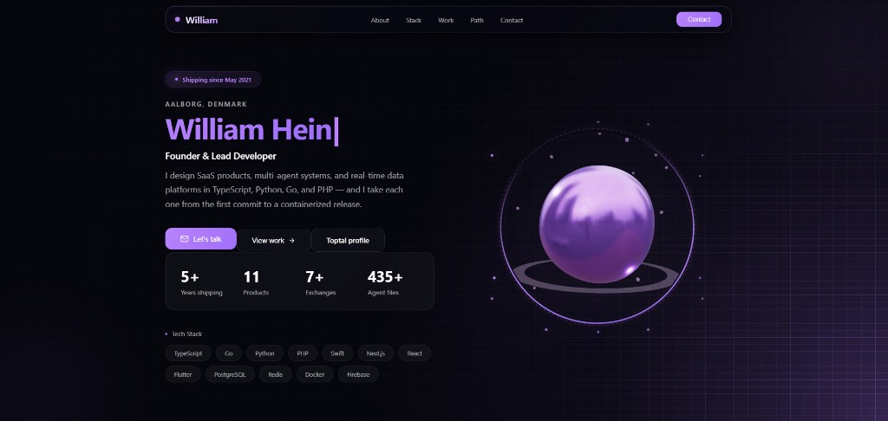

# William Hein

[](https://reactjs.org/)
[](https://threejs.org/)
[](https://www.framer.com/motion/)

Founder and lead developer at Heitech, Aalborg. This is the personal site: shipped products, the stack behind them, and a way to get in touch.

**Heitech:** [heitech.dk](https://heitech.dk) · **GitHub:** [will2022](https://github.com/will2022) · **LinkedIn:** [hein-william](https://www.linkedin.com/in/hein-william) · **Toptal:** [william-hein](https://www.toptal.com/developers/resume/william-hein#WaovPQ)

Aalborg, Denmark · +45 22 55 75 16 · william.prime.talent@gmail.com



---

## Run it

```bash
git clone https://github.com/prime-consult/my-porftolio.git
cd my-porftolio
npm install
npm start
```

The app opens at [http://localhost:3000](http://localhost:3000).

Copy, projects, skills, services, and contact links live in `src/data/PortfolioContent.js`. Live-site thumbnails are in `src/assets/images/projects/`.

---

## Contact form

The form sends through [EmailJS](https://www.emailjs.com/). Add a `.env` in the project root:

```env
REACT_APP_EMAILJS_SERVICE_ID=your_service_id
REACT_APP_EMAILJS_TEMPLATE_ID=your_template_id
REACT_APP_EMAILJS_PUBLIC_KEY=your_public_key
```

Email and phone on the page work without those keys.

---

## Deploy

Push the repo, import it on [Vercel](https://vercel.com), and add the EmailJS variables if the form should send.

---

## Stack

- React 19
- Three.js and React Three Fiber
- Framer Motion
- EmailJS

---

## William Hein

Founder and lead developer, Heitech. Aalborg, Denmark.

[](https://github.com/will2022)
[](https://www.linkedin.com/in/hein-william)
[](https://www.toptal.com/developers/resume/william-hein#WaovPQ)

**Heitech.dk · Aalborg**
